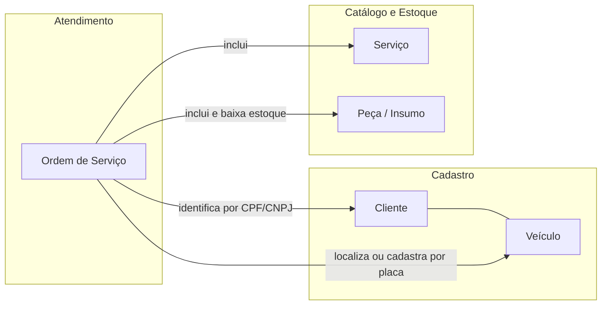
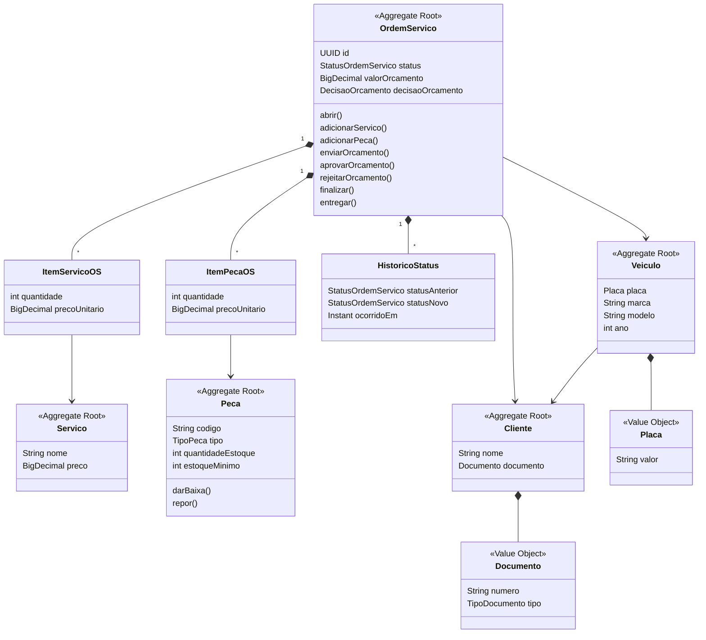
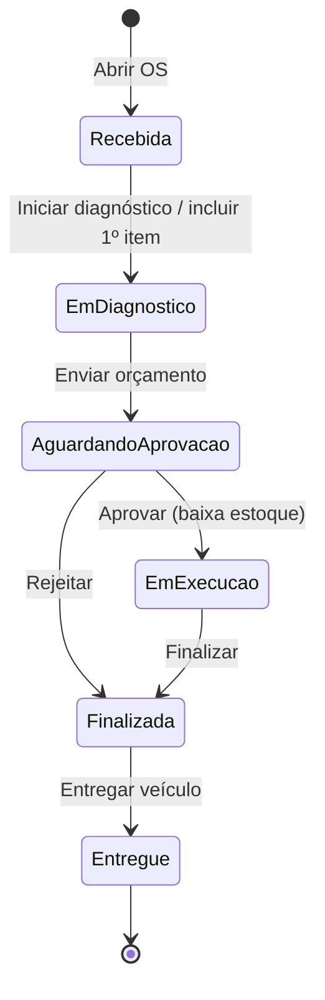

# Modelo de Domínio (DDD)

> Base para montar o Event Storming no Miro. Depois de montado, exporte para
> `docs/ddd/event-storming.pdf` e `docs/ddd/diagramas.pdf`, como pede o enunciado.

## Bounded Contexts

| Contexto | Responsabilidade | Pacotes |
|---|---|---|
| **Atendimento** (núcleo) | Ciclo de vida da OS: abertura, diagnóstico, orçamento, aprovação, execução, entrega e acompanhamento | `domain.ordemservico`, `application.OrdemServicoService`, `application.MetricasService` |
| **Cadastro de Clientes e Veículos** (suporte) | Identificação do cliente por CPF/CNPJ e dos veículos por placa | `domain.cliente`, `domain.veiculo` |
| **Catálogo e Estoque** (suporte) | Serviços oferecidos, peças/insumos e controle de saldo | `domain.catalogo` |
| **Identidade e Acesso** (genérico) | Autenticação JWT da equipe administrativa | `infrastructure.security` |

Como é um monólito (MVP), os contextos são separados por pacote e conversam por chamadas
diretas aos serviços de aplicação.

## Agregados, entidades e objetos de valor

| Agregado (raiz) | Entidades internas | Objetos de valor | Invariantes |
|---|---|---|---|
| **OrdemServico** | `ItemServicoOS`, `ItemPecaOS`, `HistoricoStatus` | `StatusOrdemServico`, `DecisaoOrcamento` | Itens só mudam em Recebida/Em diagnóstico; orçamento exige ≥1 item; transições seguem a máquina de estados; preço do item é congelado na inclusão; veículo precisa ser do cliente |
| **Cliente** | — | `Documento` (CPF/CNPJ) | Documento válido e único |
| **Veiculo** | — | `Placa` | Placa válida e única; ano entre 1900 e ano atual + 1; sempre tem dono |
| **Servico** | — | — | Preço ≥ 0; exclusão lógica |
| **Peca** | — | `TipoPeca` | Saldo nunca negativo; versionamento otimista contra baixas concorrentes; exclusão lógica |

## Máquina de estados da OS

## Event Storming

Legenda (cores usuais do Miro): 🟧 Evento de domínio · 🟦 Comando · 🟨 Ator · 🟪 Política/Regra · 🟩 Leitura · 🟫 Agregado

### 1. Criação da Ordem de Serviço

| Ator | Comando | Agregado | Evento | Política / regra |
|---|---|---|---|---|
| 🟨 Atendente | 🟦 Abrir OS (CPF/CNPJ + placa) | 🟫 OrdemServico | 🟧 **OS Aberta** | 🟪 Cliente deve existir; veículo deve ser do cliente |
| 🟨 Atendente | 🟦 Cadastrar veículo na abertura | 🟫 Veiculo | 🟧 **Veículo Cadastrado** | 🟪 Placa nova exige marca, modelo e ano |
| 🟨 Mecânico | 🟦 Iniciar diagnóstico | 🟫 OrdemServico | 🟧 **Diagnóstico Iniciado** | 🟪 Incluir o 1º item inicia o diagnóstico automaticamente |
| 🟨 Mecânico | 🟦 Incluir serviço | 🟫 OrdemServico | 🟧 **Serviço Incluído** | 🟪 Serviço ativo; preço congelado |
| 🟨 Mecânico | 🟦 Incluir peça/insumo | 🟫 OrdemServico | 🟧 **Peça Incluída** | 🟪 Saldo suficiente no estoque |
| 🟨 Atendente | 🟦 Enviar orçamento | 🟫 OrdemServico | 🟧 **Orçamento Enviado** | 🟪 ≥1 item; valor congelado → 🟪 notificar cliente |

### 2. Acompanhamento da Ordem de Serviço

| Ator | Comando | Agregado | Evento | Política / regra |
|---|---|---|---|---|
| 🟨 Cliente | 🟩 Consultar andamento | 🟫 OrdemServico | — | 🟪 Somente o titular (CPF/CNPJ) |
| 🟨 Cliente / Atendente | 🟦 Aprovar orçamento | 🟫 OrdemServico + Peca | 🟧 **Orçamento Aprovado** → 🟧 **Estoque Baixado** → 🟧 **Execução Iniciada** | 🟪 Aprovação inicia execução automaticamente |
| 🟨 Cliente / Atendente | 🟦 Rejeitar orçamento | 🟫 OrdemServico | 🟧 **Orçamento Rejeitado** → 🟧 **OS Finalizada** | 🟪 Sem execução e sem baixa |
| 🟨 Mecânico | 🟦 Finalizar serviços | 🟫 OrdemServico | 🟧 **OS Finalizada** | 🟪 Só a partir de Em execução |
| 🟨 Atendente | 🟦 Entregar veículo | 🟫 OrdemServico | 🟧 **Veículo Entregue** | 🟪 Só a partir de Finalizada |
| 🟨 Gestor | 🟩 Ver tempo médio de execução | — | — | 🟪 Considera apenas OS com execução concluída |
| 🟨 Gestor | 🟩 Ver fila de atendimento | — | — | 🟪 Prioridade por status e antiguidade |

### 3. Gestão de peças e insumos

| Ator | Comando | Agregado | Evento | Política / regra |
|---|---|---|---|---|
| 🟨 Estoquista | 🟦 Cadastrar peça/insumo | 🟫 Peca | 🟧 **Peça Cadastrada** | 🟪 Código único |
| 🟨 Estoquista | 🟦 Registrar entrada | 🟫 Peca | 🟧 **Estoque Reposto** | 🟪 Quantidade > 0 |
| 🟨 Estoquista | 🟦 Registrar saída manual | 🟫 Peca | 🟧 **Estoque Baixado** | 🟪 Saldo nunca negativo |
| (sistema) | — | 🟫 Peca | 🟧 **Estoque Abaixo do Mínimo** | 🟪 Listar para reposição (`?abaixoDoMinimo=true`) |
| 🟨 Estoquista | 🟦 Desativar peça | 🟫 Peca | 🟧 **Peça Desativada** | 🟪 Exclusão lógica preserva OS antigas |

## Relação documentação ↔ código

| Elemento DDD | Implementação |
|---|---|
| Comandos | Métodos dos serviços em `application` e endpoints `POST` em `api` |
| Eventos | Registrados em `HistoricoStatus` e notificados via porta `NotificadorCliente` |
| Políticas | Validações nos métodos do agregado (`OrdemServico`, `Peca`) e em `StatusOrdemServico.proximosPermitidos()` |
| Objetos de valor | `Documento`, `Placa` (`@Embeddable`) |
| Repositórios | Interfaces em cada pacote de domínio (`*Repository`) |
